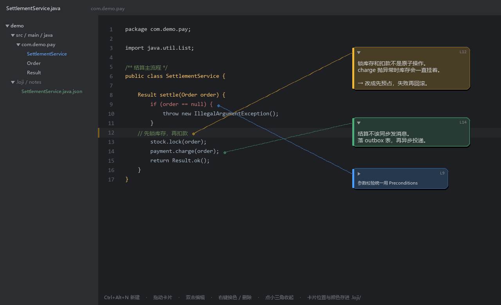
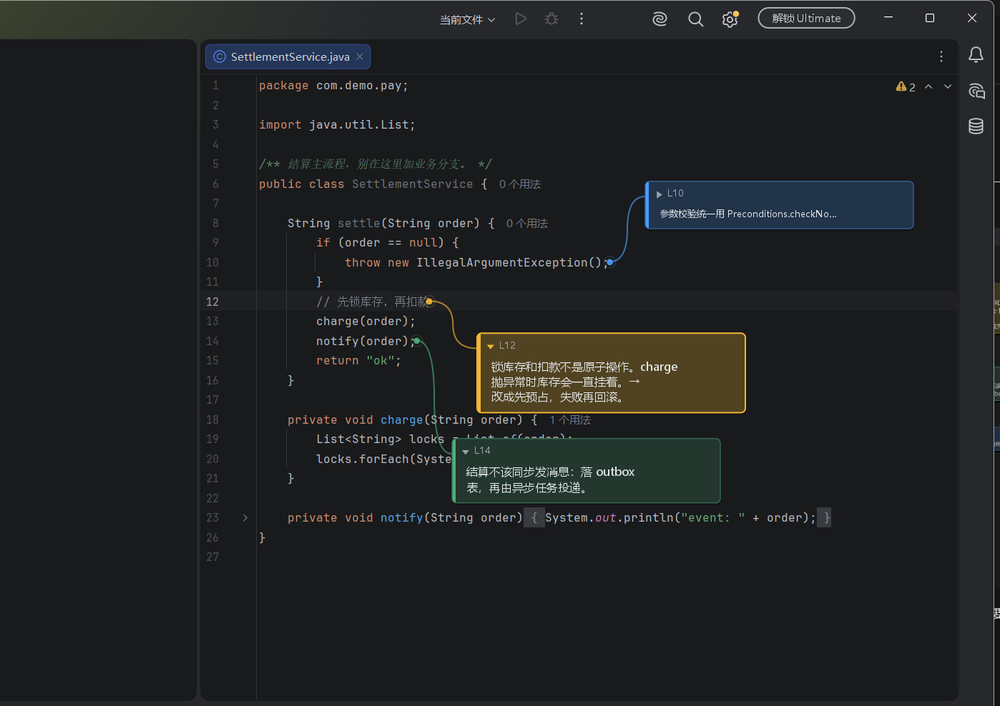

# Loji Notes · 注释栏

给代码某一行挂一张**可拖动、带指向线、可换色、可折叠**的浮动注释卡。

注释不写进源码，而是存在仓库里的 `.loji/notes/` 旁路文件中，跟 git 一起走 —— 别人 clone 下来打开同一个文件，卡片就在原位置。



（上图是按渲染规格画的效果图。下面是插件在这台机器上真实跑起来的截图，打开 `sample` 项目即可复现。）



滚动时卡片跟着代码走，锚点滚出可视区的卡片自动隐藏，滚回来原样出现。

## 安装

插件面向 **IntelliJ IDEA 2026.2 及以上**编译（build 262），从源码构建不依赖网络。

方式 A：IDEA → `Settings` → `Plugins` → 齿轮 → `Install Plugin from Disk…` → 选
`build/dist/loji-notes-0.1.0.zip` → 重启。

方式 B：解压到 `%APPDATA%\JetBrains\IntelliJIdea2026.2\plugins\`（得到 `plugins\loji-notes\lib\*.jar`）→ 重启。

## 用法

| 操作 | 效果 |
| --- | --- |
| `Ctrl+Alt+N` / 编辑器右键「新建注释栏…」 | 在光标行新建卡片，立刻进入编辑 |
| 拖动卡片 | 自由摆位置，松手即存 |
| 双击卡片 | 改文字 |
| 右键卡片 | 换 6 种颜色之一 / 收起 / 展开 / 跳到锚点行 / 删除 |
| 点卡片左上小三角 | 收起成一条，省空间 |
| `Ctrl+Alt+Shift+N` | 全局收放所有卡片 |
| 单击卡片 | 光标跳到它指向的那一行（卡片跟着滑） |

卡片位置、颜色、折叠状态都落在 json 里，别人打开就是同一个布局。

## 数据在哪

```
<项目根>/.loji/notes/<源文件相对路径>.json
```

一次示例：

```json
{
  "format": "loji-notes",
  "version": 1,
  "file": "src/main/java/com/demo/pay/SettlementService.java",
  "notes": [
    {
      "id": "n_stock0001",
      "line": 11,
      "fingerprint": "87255f55e1cf3086",
      "ctxBefore": ["        }", "        // 先锁库存，再扣款"],
      "ctxAfter": ["        notify(order);", "        return \"ok\";"],
      "text": "锁库存和扣款不是原子操作……",
      "color": "amber",
      "dx": 40, "dy": 10,
      "collapsed": false,
      "created": 1755000000000, "updated": 1755000000000,
      "author": "loji"
    }
  ]
}
```

**建议把 `.loji/` 提交进版本库**，这才能"换台电脑也能看到"。不想让别人看到，就把它加进 `.git/info/exclude`；插件不在别处存状态。

## 代码漂移怎么办

锚点 = 行号 + 目标行指纹 + 上下各 2 行上下文。

- 文件打开时做一次校正：在原行附近 ±400 行内按「指纹命中 / 上下文相似度」重新定位，命中就改行号并回写 json。
- 定位不到时卡片边框变虚线、标「锚点丢失」，仍然显示原文，不会硬指到无关行上。
- 编辑过程中有 300ms 去抖，边打字边校正，不会每次按键都全盘搜索。

## 自己构建

构建不依赖 Gradle：直接调用 IDEA 自带的 `jbr` + `kotlinc` 编译打包，全程离线。

```
build.cmd            :: 编译 + 打包
build.cmd -Test      :: 顺便跑纯逻辑自测
```

也可以指定别的 IDEA 安装：

```
build.cmd -IdeaHome "D:\JetBrains\IntelliJ IDEA 2026.2.1"
```

产物：

- `build/dist/loji-notes/lib/loji-notes.jar` — 插件本体
- `build/dist/loji-notes-0.1.0.zip` — 可安装包

## 试玩

打开仓库里的 `sample` 目录当项目，再打开
`src/main/java/com/demo/pay/SettlementService.java`，三张卡片会直接出现（数据在 `sample/.loji/`）。改几行代码再保存，看卡片怎么跟着走。

## 目录

```
src/main/kotlin/loji/notes/
  anchor/Anchor.kt        锚点指纹与重定位
  model/Note.kt           注释模型
  model/Palette.kt        六色
  store/Json.kt           手写 JSON（零依赖）
  store/NoteStore.kt      侧车文件读写
  LojiService.kt          项目级仓库：缓存 / 校正 / 落盘
  OverlayHost.kt          把画布挂到主窗口 POPUP 层
  ui/NoteOverlay.kt       透明画布：卡片、指向线、拖动、菜单
  ui/NotePopup.kt         编辑弹窗
  actions/                新建、全局收放
src/test/kotlin/          SelfTest（38 项，纯 JVM 可跑）
tools/                    打包、预览图、示例数据生成
```

## 已知边界

- 只处理本地文件项目；`.loji` 自身与远程/非本地文件系统跳过。
- 卡片坐标按像素存，换字号或窗口变窄后会按屏幕边界夹住，不会跑到窗外，但位置可能与上次摆放略有出入。
- 锚点搜索窗口 ±400 行；整段代码被挪到千里之外，会判为失联而不是乱指。
- 同一行可以挂多张卡，默认位置会叠在一起，需要手动拖开。

## 发布到 JetBrains Marketplace

上架后别人能在 `Settings → Plugins → Marketplace` 里直接搜到、一键装，后续更新也会自动推送。

1. **注册账号**：<https://account.jetbrains.com> 用任意邮箱注册，免费。
2. **上传**：登录后打开 <https://plugins.jetbrains.com/author/me/upload>，选
   `build/dist/loji-notes-0.1.0.zip`，填表（名字、描述、类别、标签、许可证、源码地址），提交。
3. **等审核**：新插件人工审核，通常 1–3 个工作日。插件 ID `dev.loji.notes` 首次上传后就被占用，不能再改。
4. **上架后**：搜索页地址形如 `https://plugins.jetbrains.com/plugin/<数字>/loji-notes`，
   用户在 IDE 里装的就是这个版本。

注意：

- 上传的 zip 里必须包含 `META-INF/plugin.xml` 与图标，`build.cmd` 打出的包已经满足。
- `since-build="262"` 表示只对 2026.2 及以后可见；想放宽就把这个值调低，但要用对应版本的 API 重新编译。
- 想让卡片在搜索页好看，先准备 2–3 张截图（编辑器里的实际效果）作为 Marketplace 的展示图。

**更新版本**：改 `build.cmd -Version 0.1.1` 重新打包，到同一个上传页覆盖提交；更新版本一般自动过审。

**不想上架也能分发**：

- 直接把 zip 发给对方，`Settings → Plugins → ⚙ → Install Plugin from Disk…`。
- 或者自己托管一个 `updatePlugins.xml`（JetBrains 的私有仓库格式），指向 zip 的下载地址，
  别人在 `Settings → Plugins → ⚙ → Manage Plugin Repositories…` 里加上这个 URL，之后就能收到更新。

## 关于 VS Code

VS Code 的扩展 API **没有**"在编辑器上层自由绘制"的能力：装饰器只能画在行尾/概览栏，webview 只能占据独立区域。所以同样的体验在 VS Code 里得换个形态 —— 停靠式注释轨：右侧一列卡片，滚动联动，指向线连到对应行号。数据格式可以完全复用（同一份 `.loji/`），两边互相看得见。

VS Code 版本尚未实现，界面形态待定。
